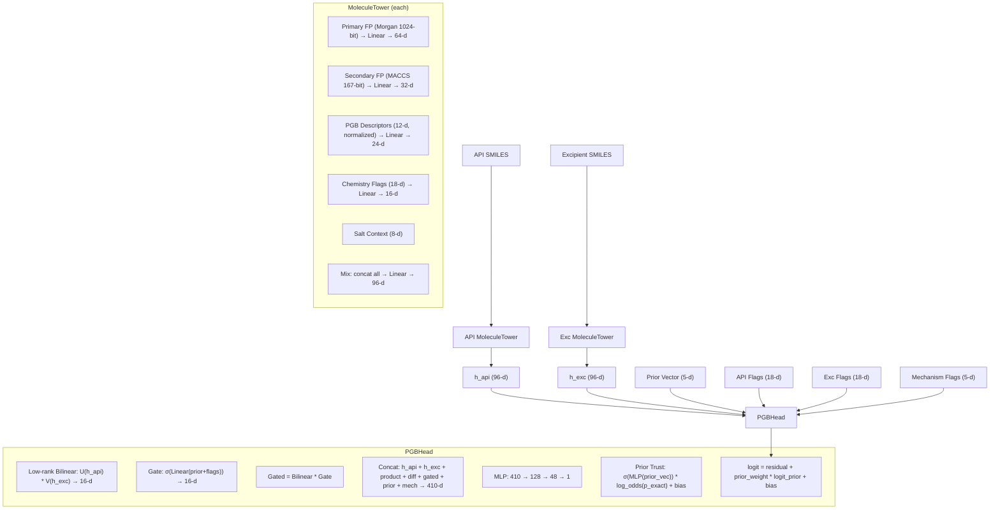

# SHAP Analysis Plan — PGB Morgan Model

## What is the PGB Morgan Model?

The **PGB (Prior-Gated Bilinear) Morgan** model predicts **API–Excipient compatibility** (binary: compatible vs. incompatible). It's a fixed-vector model (no sequence encoder) that uses **1024-bit Morgan fingerprints** as the primary feature and **167-bit MACCS keys** as the secondary feature.

### Architecture Recap



---

## All Possible SHAP Analyses on This Model

### 1. 🎯 **Feature Group Attribution (Main Analysis)**

> **What**: Which *feature groups* matter most for predictions?

The PGB Morgan model uses **7 distinct feature groups** for each molecule (API and excipient), giving **~14 input blocks** total, plus 3 pair-level inputs:

| # | Feature Group | Dim | Description |
|---|-------------|-----|-------------|
| 1 | `api_primary` (Morgan FP) | 1024 | API Morgan fingerprint bits |
| 2 | `exc_primary` (Morgan FP) | 1024 | Excipient Morgan fingerprint bits |
| 3 | `api_secondary` (MACCS) | 167 | API MACCS key bits |
| 4 | `exc_secondary` (MACCS) | 167 | Excipient MACCS key bits |
| 5 | `api_pgb_desc` | 12 | API physicochemical descriptors |
| 6 | `exc_pgb_desc` | 12 | Excipient physicochemical descriptors |
| 7 | `api_flags` | 18 | API chemistry flags |
| 8 | `exc_flags` | 18 | Excipient chemistry flags |
| 9 | `api_salt` | 8 | API salt context features |
| 10 | `exc_salt` | 8 | Excipient salt context features |
| 11 | `prior_vec` | 5 | Excipient prior (p_exact, p_delta, p_family, log_n, unseen) |
| 12 | `mech_flags` | 5 | Mechanism reaction flags (Maillard, hydrolysis, etc.) |

**SHAP approach**: Flatten all inputs into a single feature vector (**~2,468-d**), wrap the model as `f(x) → logit`, run **KernelSHAP** or **DeepSHAP** on this flat vector, then group SHAP values by feature group.

**What you'll learn**: Relative importance of Morgan FP vs. MACCS vs. descriptors vs. prior vs. mechanism flags.

---

### 2. 🔬 **Individual Morgan Fingerprint Bit Attribution**

> **What**: Which specific Morgan FP bits drive incompatibility predictions?

Since the primary feature is a **1024-bit Morgan fingerprint**, SHAP can reveal which individual bits (substructures) are most influential. Each bit corresponds to a specific circular substructure at radius 2.

**SHAP approach**: Run SHAP on the flat vector, extract SHAP values for the 1024 Morgan bit positions. Rank by mean |SHAP|.

**What you'll learn**: 
- Top-20 most predictive substructural fragments
- You can decode the bit indices back to actual substructures using RDKit's `GetMorganGenerator().GetInfoDict()` to identify the chemical meaning

---

### 3. 📊 **Physicochemical Descriptor Attribution**

> **What**: Which of the 12 PGB descriptors matter most?

The 12 named descriptors are highly interpretable:

| Index | Descriptor |
|-------|-----------|
| 0 | MolWt |
| 1 | MolLogP |
| 2 | TPSA |
| 3 | NumHDonors |
| 4 | NumHAcceptors |
| 5 | NumRotatableBonds |
| 6 | NumAromaticRings |
| 7 | RingCount |
| 8 | FractionCSP3 |
| 9 | HeavyAtomCount |
| 10 | NumHeteroatoms |
| 11 | QED |

**SHAP approach**: Extract SHAP values for the 12 API descriptor positions and 12 excipient descriptor positions separately. Create **beeswarm** and **bar** plots.

**What you'll learn**: E.g., "High excipient MolWt pushes toward compatibility" or "API TPSA is the most discriminative descriptor."

---

### 4. ⚗️ **Chemistry Flag Attribution**

> **What**: Which of the 18 chemistry flags are most impactful?

The 18 named flags are:
`no_carbons, oxidizer, strong_acid, strong_base, has_metal, has_Mg, has_Ca, has_Al, has_Si, has_Ti_Fe, has_Mn_Cr, is_salt, very_short, many_OH, has_amine, carboxylic_acid, ester, phenol`

**SHAP approach**: Extract SHAP values for flag positions. Since flags are binary, a SHAP **heatmap** or **bar plot** is ideal.

**What you'll learn**: Which structural/chemical properties (e.g., "is_salt", "has_metal") most strongly influence incompatibility.

---

### 5. 🧪 **Mechanism Flag Attribution**

> **What**: How much do the 5 reaction mechanism flags contribute?

The 5 mechanisms are:
1. Maillard reaction
2. Ester/amide hydrolysis
3. Metal-ion catalyzed oxidation
4. Acid-base salt displacement
5. Schiff base formation

**SHAP approach**: Extract SHAP values for the 5 mechanism flag positions. Very interpretable — directly maps to known chemical reactions.

**What you'll learn**: Whether the model actually leverages known incompatibility mechanisms or ignores them.

---

### 6. 📈 **Prior Vector Attribution**

> **What**: How much does the Bayesian excipient prior influence predictions vs. the neural network?

The prior vector has 5 components: `[p_exact, p_delta, p_family, log_n, unseen]`

**SHAP approach**: Extract SHAP values for prior_vec positions. This is especially insightful because the PGBHead has an *explicit* prior trust mechanism.

**What you'll learn**: 
- Does the model trust the Bayesian prior more for well-known excipients?
- Does `unseen` flag significantly shift predictions?
- How much of the prediction is "data-driven" vs. "prior-driven"?

---

### 7. 🔥 **Per-Sample Waterfall / Force Plots**

> **What**: For a specific API–Excipient pair, *why* did the model predict compatible/incompatible?

**SHAP approach**: For any individual sample, generate a **waterfall plot** or **force plot** showing the top features pushing the prediction toward compatible vs. incompatible.

**What you'll learn**: Full interpretability for individual predictions — critical for pharmacological review and regulatory explanation.

---

### 8. 🗺️ **SHAP Dependence Plots**

> **What**: How does a feature's value interact with another feature to influence predictions?

**SHAP approach**: SHAP dependence plots for top features (e.g., `api_MolLogP` vs. `exc_TPSA`), showing interaction effects.

**What you'll learn**: Non-linear and interaction effects — e.g., "High API LogP combined with low Excipient TPSA strongly predicts incompatibility."

---

### 9. 🏗️ **Tower-Level Attribution (API Tower vs. Excipient Tower)**

> **What**: Does the API molecule or the excipient molecule contribute more to the prediction?

**SHAP approach**: Instead of flat features, wrap the model at the tower output level — `f(h_api, h_exc, prior, flags) → logit` where h_api and h_exc are 96-d each. Run SHAP on this 222-d intermediate representation.

**What you'll learn**: Whether the model is "API-driven" (certain APIs are universally problematic) or "excipient-driven" (certain excipients are universally risky) or "pair-driven" (interactions matter most).

---

### 10. 🎭 **Incompatible vs. Compatible Class Comparison**

> **What**: What features differ between true positive (correctly predicted incompatible) and true negative (correctly predicted compatible) samples?

**SHAP approach**: Partition test set by prediction class, compute SHAP for each group, then compare mean SHAP value distributions.

**What you'll learn**: Feature signatures of incompatibility — which features the model considers the strongest "red flags."

---

## Recommended Implementation Plan

| Priority | Analysis | Output |
|----------|---------|--------|
| ⭐ P0 | Feature Group Attribution (#1) | Bar plot: group importance |
| ⭐ P0 | Per-Sample Waterfall (#7) | Waterfall plots for select pairs |
| 🔵 P1 | Descriptor Attribution (#3) | Beeswarm + bar plots |
| 🔵 P1 | Chemistry Flag Attribution (#4) | Bar + heatmap |
| 🔵 P1 | Mechanism Flag Attribution (#5) | Bar plot |
| 🔵 P1 | Prior Vector Attribution (#6) | Bar + dependence plot |
| 🟢 P2 | Morgan Bit Attribution (#2) | Top-20 bits decoded |
| 🟢 P2 | Dependence Plots (#8) | Top interaction pairs |
| 🟢 P2 | Tower-Level Attribution (#9) | API vs. Exc importance |
| 🟢 P2 | Class Comparison (#10) | Comparative bar plots |

---

## Folder Structure

```
shap_analysis/
├── __init__.py
├── config.py              # SHAP config (background size, etc.)
├── model_wrapper.py       # Wraps PGBCompatibilityModel for SHAP
├── run_shap.py            # Main script to compute SHAP values
├── plots.py               # All SHAP visualization functions
├── feature_names.py       # Human-readable feature name mapping
├── utils.py               # Bit decoding, data loading helpers
├── results/               # Saved SHAP values + plots
│   ├── shap_values.npz
│   ├── feature_importance.csv
│   ├── plots/
│   │   ├── feature_group_importance.png
│   │   ├── descriptor_beeswarm.png
│   │   ├── chemistry_flags_bar.png
│   │   ├── mechanism_flags_bar.png
│   │   ├── prior_attribution.png
│   │   ├── waterfall_sample_*.png
│   │   ├── morgan_top_bits.png
│   │   └── dependence_*.png
│   └── summary_report.md
└── README.md
```
